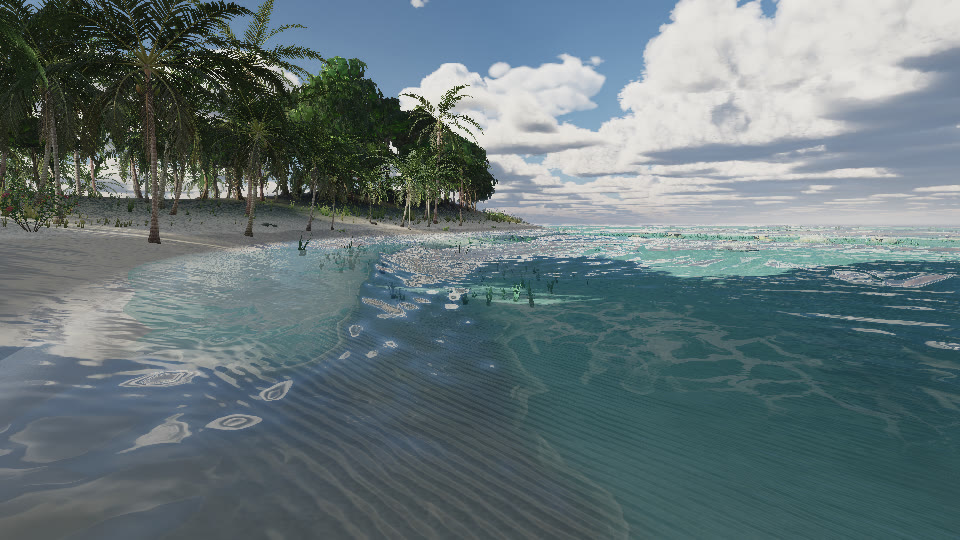
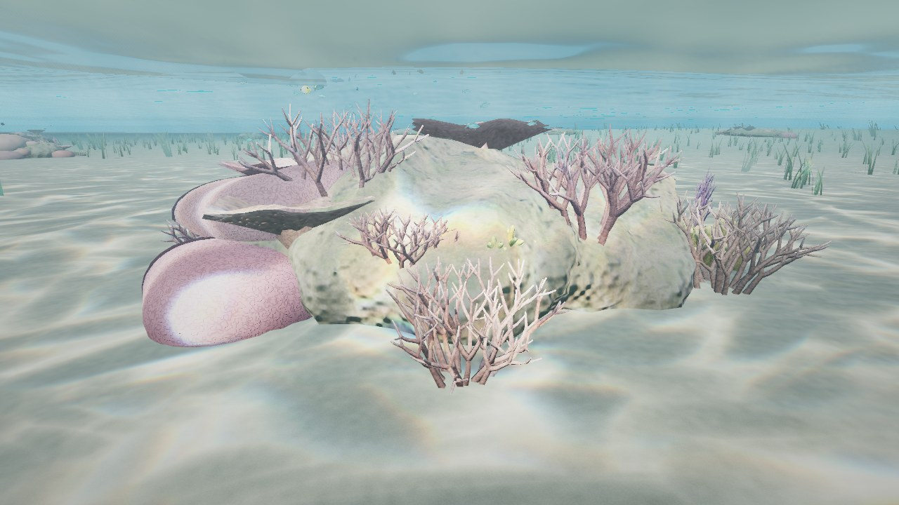

# Windward

A small island you can walk, swim, and fly, drawn in the browser with WebGPU. The coast, the swell, the reef, the trees, the insects, the weather, and the sound are all computed when the page opens. The day passes, and the weather comes and goes. There are no image files, no 3D models, and no audio files. The page you open is one HTML file.

It is in the same spirit as [Abyssal Garden](https://github.com/Noniv/abyssal-garden): one self-contained page, no engine, everything procedural. Techniques shared with that project — Beer's-law water fog, interference caustics, height-powered plant sway, Snell-window surface look, and procedural underwater ambience — are adapted here for a tropical island above and below the waterline.

**[Try it in your browser](https://jordanz00.github.io/Windward/)** · Best in Chrome. It also runs in Edge, and on a phone at Low detail. Free, and open source under the MIT license.



## Try it

Open the [live page](https://jordanz00.github.io/Windward/), or clone the repository and open `index.html` in Chrome. WebGPU wants a normal browser context; if a double-click does nothing useful, use a local server:

```bash
python3 -m http.server 4177
```

Wait for the coast to finish generating, then press **Enter**. You arrive over the lagoon. **Walk** uses FPS mouse-look (click the view to lock). **Places** orbits a body of water — drag to look, scroll to zoom, click the water. **Fly** (`F`) leaves the ground. **Watch**, or `C`, hides the interface.

| | |
|---|---|
| Look (Walk / Fly) | Click to lock the mouse. Esc releases |
| Look (Places) | Drag. Scroll zooms |
| Move | `W` `A` `S` `D` · Shift run / boost |
| Ripple | Click or tap the water |
| Travel | Places · `1`–`6` |
| Fly | `F` · Space up · Ctrl down |
| Dive / rise | `Q` dive · Space rise while walking |
| Just watch | Watch, or `C`. Esc brings the controls back |
| Time of day | Hour, or `T` (Shift goes back) |
| Weather | Weather, or `R` (Shift goes back) |
| Mute | `M` |
| Music and effects | `N` music · `X` sound effects · `[` `]` music level |
| Frame time | `H` — FPS, CPU ms, GPU ms (when supported), and whether the frame looks CPU- or GPU-bound. Never silently lowers quality |
| Benchmark | `B` — timed fly-through with FPS / 1% low / CPU / cull / GPU / draws / passes; `G` flies the same path. `?bench=1` starts it after Enter |
| Menu | `Esc` |

On a phone, drag to look while walking and tap the water. A second finger is Shift. **Menu** brings the card back.

Low, Medium, and High are the same island with less or more in it. The choice is remembered. If a load dies, the next one steps down a level.

You stay on the sand. Step into the water and you swim; hold `Q` to go under and look up through the surface. Once you are properly under you stay at that depth and swim slowly, so the fish can be watched. `6` puts you beside a coral head in the lagoon. `F` lets the camera leave the ground.

| | |
|---|---|
|  |  |

## How it is built

`source/` is the readable copy. `node source/build.mjs` writes `index.html` next to this file and prints source, page, gzip and brotli sizes. The shipped page strips comments and spare whitespace (including inside WGSL templates) but keeps names unchanged so runtime errors still map to written identifiers. `node source/build.mjs --dev` writes the page with the source as it is.

| File | What it is |
|---|---|
| `source/gpu.js` | Four helpers that every layout, bind group, render target and pass is written with |
| `source/island.js` | The fixed-seed coast: beach, cliffs, bay, reef, and where the swell is allowed to stand up |
| `source/sky.js` | Sky: noise volume, weather map, cloud shadow map, panorama bake, and their WGSL |
| `source/shaders.js` | WGSL: terrain, plants, the air pass, and the water |
| `source/ocean.js` | The spectral sea: three FFT wave tiles, the slopes that glitter, and the one lookup the sea shader and the surf solver both read them with |
| `source/shore.js` | Shallow water on the beach: run-up, foam, and the sand it leaves wet |
| `source/fish.js` | The reef and what lives on it: coral, seagrass, eight kinds of fish, and how they behave |
| `source/env.js` | The one state everything reads: the hour, the sun and moon, the weather, the wind |
| `source/insects.js` | Ten kinds of insect, the flowering shrubs they visit, and how they behave |
| `source/app.js` | WebGPU, the camera, the boats and trees, the sound |
| `source/bench.js` | Repeatable fly-through benchmark (frame + GPU times), after Abyssal Garden’s `dev.js` |
| `source/ui.css` | The card on top of the picture |
| `source/build.mjs` | Joins the files above into `index.html` and reports the sizes |

The seabed is a height field filled on the CPU once, then read by the GPU. Sunlight is a depth map of the ground and the trees, so a trunk throws a shadow across the sand and into the water. Plants and rocks are a few dozen prototype meshes, built once and drawn as instances; the wind moves the tips more than the trunk. Sound is synthesised in the Web Audio API.

Nothing is allocated per frame on purpose: the uniform buffer, the bird list, and the scratch matrices are reused.

### Water

- **Swell.** A Gerstner swell runs with the wind, with a bound harmonic that peaks the crests. It stays low offshore and stands up where the bottom shoals; there the crest leans forward and breaks into foam. The lagoon stays sheltered.
- **Chop.** The shorter waves are three spectral tiles solved on the GPU, on two headings and two scales, so the crests do not repeat as one pattern. The finest carries the 0.45 to 5 m chop that gives water its texture, and drops out once a pixel is wider than the wave.
- **Shore.** On the beach a shallow-water grid, finer than the island mesh, takes the swell onto the sand. The water runs up as a thin sheet from its own momentum, and the foam is carried with that flow as a network whose ribbons widen with the simulated density. Wet sand reflects the sky.
- **Surface.** The mesh is packed tightly around the camera and runs out to the haze, so a crest nearby stays a curve; past the mesh the same sea is drawn to the horizon. A half-resolution mirror puts the island in the water. The sun path is the facets of the surface: a pixel lights only when a facet faces the sun.
- **Colour.** Colour comes from depth: sand shows through the shallows, red light dies first offshore, and the glancing angle reflects the sky. The surface bends the view of the bottom. From below, the disk of sky is the refraction out of the water; outside that cone the surface reflects.
- **Ripples.** A click writes into a height field on the GPU. The impulse is a crest with a trough around it, so the ring reads as a disturbance in the surface rather than a flat circle. It travels, meets the next click, and dies away.

### Places and music

Six places are worth the trip, and each sets where the camera sits: Palm Beach, Cliff Overlook, Island From Above, Lagoon Shallows, Offshore and Coral Garden.

Under the surf and the birds, an original score called Beneath the Blue unfolds at a slow tempo: written chords and melodic phrases, played by a pad, a bell, a soft pluck, and a rounded bass. `N` quiets it. The bracket keys set its presence.

### Geometry, light and startup

- **Instances.** Every plant, rock and boat is one of a few dozen prototype meshes in a single vertex buffer. Each placed copy is twelve floats: position, yaw, scale, tint. Every frame the CPU culls the copies against the view, picks a level of detail by distance, and writes one instance buffer that serves the main view, the mirror and the near shadow map.
- **Palms.** A coconut palm is a curved, tapering trunk with leaf-scar rings and 20 to 26 fronds placed by age: young ones upright, old ones hanging and yellowing. Each frond is a curved rachis carrying separate folded leaflets. Three levels of detail share the same fronds, so a palm does not change shape as it recedes. Close to, the bark is fibre cracked across, with the lip of each leaf scar standing proud.
- **Forest trees.** A bowed trunk that flares into buttress roots, one limb to each mass of leaves, and five to eight leaf masses forming a spreading crown. The crown's surface is shaded as leaves, not as a blob: cells of single leaves with a midrib, lit on top and dark inside, thinning to sky at the silhouette. Bark is furrowed up the trunk with lichen in patches. Nine shapes, three levels of detail each.
- **Forest floor.** Close to, fallen leaves lie on the ground, thick under the canopy and scattered on the open turf, and the turf is tufted. Sparse fallen palm fronds sit under the grove. Ferns, tree ferns and coastal shrubs use habitat-aware placement.
- **Grass.** A tuft is nine thin blades, each bent in two segments. Tufts are sown at many sizes with smaller ones round each, so cover is dense without being even. Gusts roll through as waves, the tips flutter on top of that, and blades lean away and lie down where you walk.
- **Boulders.** A lump cut along planes, then shaded with shared normals so the cuts read as worn faces instead of polygons.
- **Shadows.** One depth map covers the island and is redrawn only when the sun moves. A second, 2048 texels across 52 m, follows the viewer so leaflets and trunks cast sharp shadows on the sand nearby.
- **Sky.** One atmosphere, in `source/sky.js`. A weather map centred on the island says where the air holds cumulus, where a convective tower stands and how far along its life it is, where its anvil has spread, and where a stratocumulus deck lies; humidity sets the cloud base, instability the depth of the cumulus and the height of the towers, and each layer drifts with its own wind. Clouds are marched through a tileable noise volume made once on the GPU, with a height profile for each family, light attenuated toward the sun, and forward and multiple scattering. Cirrus is a thin sheet of fibres on the upper wind. The air is Rayleigh, Mie and ozone, with the sun's path worked out by Chapman's function so the same sum reddens the sun, the clouds and the ground. The result is a panorama kept as two copies, baked a strip per frame in turn and read as a blend, so no bake is seen arriving; a coarse copy of it lights the land.
- **Cloud shadow and shafts.** The same clouds are marched once toward the sun into a shadow map. The land, the sea, the air pass and the animals read it, so a shadow on the sand belongs to a cloud that is in the sky. In the panorama the air's own light is taken away along each stretch of a view ray that lies in cloud shadow, which leaves the lit air between as shafts, in space and not on the screen.
- **Sand.** Dry sand is shaded from a height: pits with raised rims, wind ripples in patches, and grain. Each scale is left out once it is smaller than a pixel. Below a ragged line the sand is damp, darker and smooth, and the last high wash has left a wrack line.
- **Startup.** Pipelines compile in parallel while the height field, the planting, the wave spectra and the surf grid are made, with the sea's shader started first because it takes longest. The first picture waits only for the sky, the land, the plants, their shadows and the sea. The wash on the sand, the shafts in the air, the grass, the birds, fish, insects and rain are drawn from the frame their pipeline arrives, a fraction of a second later. `window.__perf` holds the time of each startup step in milliseconds, and `?perf` in the address logs it.
- **Antialiasing (experimental, off by default).** `?msaa=4` draws the scene and its mirror with four samples to the pixel, so a leaflet thinner than a pixel fades instead of flickering as it sways, and levels of detail cross-fade through the same samples, a leaf at a time. It is off by default because it drew trees and coral in stray colours on a Mac; the cause is not yet found.
- **One of each.** Trunks, limbs, stems, coral branches and insect legs are swept by one `tube` function. Plants, rocks, boats, coral, fish and insects share one 32-byte vertex (position as floats, normal, colour and texture coordinate as half floats) and 16-bit indices. The sea shader and the surf solver read the wave tiles through the same lookup, the two sun glints on water are one GGX lobe, and the gust at a point is one function that the leaves, the birds, the insects and the sound all ask.

### Under the water

- **The reef.** Coral grows in heads on firm ground one to three and a half metres down, thickest along the reef across the bay mouth. A head is a mound of old coral rock with living coral over it and round its foot: thickets of thin branches, clumps of blunt fingers, sea fans that bend with the surge, grooved boulders, tables, and sometimes an anemone. Seagrass grows in meadows on the calm lagoon sand, and the sand itself is combed into ripples. All of it is the same instanced prototypes as the plants on land.
- **The fish.** Eight original species, each with its own outline built from a profile: a small blue-green chromis, an orange anemonefish with one white bar, a disc-shaped butterflyfish with a false eye, a ringed angelfish, a blunt-headed parrotfish with scales large enough to count, a sand goby, a silver trevally and a yellow-striped fusilier. A fish is a lofted body with a tail fin, dorsal and anal fins, paired fins and eyes, in three levels of detail. The fins it rows with are drawn as clear film on rays.
- **Swimming.** A fish instance is twelve floats. The vertex shader bends the body with a wave that runs from head to tail and grows as it goes, bends the whole fish into a turn, and sculls the paired fins. The tail beats faster the faster the fish goes and stops when it glides. Small fish move in bursts; large ones hold a steady pace.
- **Behaviour.** A school knows where it is going: a home to hover over, or a round of stops to travel and linger at. A fish knows its wandering place in the school, its neighbours, the bottom ahead, the surface, the coral in its way, the larger fish that frighten it, and you. Chromis hover over branching coral, anemonefish keep to their anemone, butterflyfish and angelfish work from head to head, parrotfish tip down to graze, gobies sit on the sand and dart, trevally patrol the lagoon and pass close by the coral, fusiliers stream along the seaward face of the reef, and a few large fish cruise the deep water alone. When a trevally passes, or you swim in among them, a school tightens and moves off, then drifts back.
- **Cost.** Schools near you are stepped every frame with every rule. Further out they are stepped one frame in three without the neighbour rules. Beyond that only the school moves, and its fish are carried along when they come back into range. Fish are culled against the view and drawn in one buffer, one draw per species and level of detail.
- **Light.** Under water the sun loses its red with depth, the ripples gather it into a net of bright threads on the bed, fringed with colour where the light splits and cast along the sun as the surface bends it, the water itself lights the shaded side of things, and distance fades everything toward the colour of the water. Outside the window of sky, the underside of the surface mirrors the bottom.

### The day, the weather and the air

- **One environment.** `env.js` holds a clock, a weather state and a wind, and everything else reads them: the sun and sky, the sea's height and chop, the plants, the rain, the insects and the sound. Nothing has a time of day of its own.
- **The day.** The sun rides a tilted circle through the sky, rising at six and setting at eighteen. Its colour is what is left after its path through the air, so it reddens as it drops; the sky's own light is tracked separately and takes over through twilight; after that a pale moon lights the ground. Exposure opens as the light goes, but not all the way, so night is dark, and it closes when the camera faces the sun. Nothing tints the picture: the warmth of a low sun is what the air has left of it. A full day takes about an hour and a half unless you step it. The stops are first light, morning, midday, afternoon, golden hour, sunset, blue hour and night.
- **Weather.** Clear, passing clouds, gusty, overcast, light rain, a tropical shower, the hour after rain, and morning mist. Each is a row of numbers: cloud cover, rain, mist, humidity, wind speed, gustiness. The state eases from one row to the next over a minute or so, and left alone it wanders between kinds that follow one another. Ground gets wet while it rains and dries afterwards; dew and mist form at dawn and burn off as the sun climbs.
- **Wind.** One field: a prevailing direction that meanders, a speed, and gusts that travel downwind as patches a few tens of metres across. Palms lean and rock at a rate set by their own size, fronds and leaves flutter on top of that, plants in the lee of the forest move less, grass bends, the small chop on the sea grows with the wind, clouds drift with it, rain slants with it, and insects are carried by it.
- **Air.** Distance fades toward the colour of the horizon in that direction, with blue scattered out first and a low humid layer that thickens with moisture and rain. On top of that a half-resolution pass marches each view ray through the near air against the shadow maps, so where there is mist, damp forest air, spray over the surf or rain, sunlight shows as shafts between whatever is shading it and disappears when the sun is covered. Each step asks the shadow map three times, since what the leaves let through changes faster along a ray than the air does. Each step adds the sunlight that reaches it, past the leaves and past the clouds, by a normalised forward phase, and the light of the sky; nothing else is added to make a shaft. Under water the same pass draws the rays that come down through the surface.
- **Rain and spray.** Rain is streaks that fall at the speed and slant the wind gives them, in a volume that moves with you, with a splash where a drop meets the ground and rings on still water. Wet sand and leaves darken and shine. Spray is thrown where the surf simulation says water is breaking, and blown downwind. Fine motes show in humid air against the light.

### Insects

- **Kinds.** Dragonflies and damselflies over still shallows, butterflies, bees and dusk moths at blossoms, gnats dancing in loose balls at the forest edge, mosquitoes in shade, beetles and ants in the leaf litter, fireflies under the trees after dark. Each is a mesh built from lobes, limbs and wings: segmented bodies, compound eyes, six legs, antennae, veined clear wings or scaled patterned ones.
- **Flowers.** Hibiscus-like shrubs grow in the sun: arching woody stems, glossy leaves, five-petalled blossoms with a column of stamens. Every open blossom is a place a bee or a butterfly can go.
- **Behaviour.** A dragonfly hovers, snaps round, darts to another point over the water, and sometimes settles on the bank with its wings held flat. A butterfly flies an unsteady line to a blossom and rests with its wings shut, opening them slowly. A bee flies straight to a shrub, hangs in front of a blossom, lands, and moves to the next one along. Gnats rise and fall on their own beat round a point that drifts. Ants keep to a trail, a little off the line, and some carry a piece of leaf home. Fireflies on the wing flash on their own count and the ones sitting in the leaves answer.
- **When and where.** How many of each kind are out follows the sun, the rain, the wind and the cloud: bees and butterflies in bright calm hours, gnats and moths toward dusk, fireflies in the dark, almost nothing flying in a shower. Only the animals near you are simulated and drawn; when you move on they are given homes where you have gone. Nothing flies at the camera: within arm's reach it veers off.
- **Cost.** An insect instance is twenty-four floats. The vertex shader beats the wings, swings the legs and places the animal. All insects are one buffer and one draw per kind and level of detail, drawn after the water so a clear wing over the lagoon is a film over the lagoon.

### Sound

Surf, wind and birds are the bed. Over them, cicada-like rasps sing in bouts through the heat of the day, loudest among trees; crickets chirp after dusk, each with its own pitch, pulse count and pace; a far chorus shimmers at night; birds sing most at first light and stop for rain, each singer with a phrase of its own that it repeats and another of its kind sometimes answers (a warbler's run of slurred notes, a dove's three low notes, a trill, gulls crying over the shore); rain has a hiss and a patter, with single drops off the leaves under trees; gusts rustle the canopy; and a bee, a mosquito or a dragonfly that comes close can be heard. Every layer is driven by the same hour, weather and place as the picture, and none of it is a recording or a loop.

### Capture parameters

For captures, `?tod=<hour>` sets the clock, `?wx=<clear|clouds|gusts|overcast|drizzle|shower|after|mist>` sets the weather, and `&flow` lets both run. `&bug=<kind>` frames the nearest insect of that kind (`bd` is the distance in metres, `bst` its state, `hold` keeps it there, `bat=<n>` goes to the n-th place that kind lives first). `&sunview=<0..1>` faces the sun, pitched up by that share of its height, and `&shade` stands in the shadow of the nearest palm crown. `&bird=<metres>` flies three gulls past the camera at that distance. `&rf=<frame>` reads the picture back at that frame instead of the sixteenth.

`?shot=6` with `&fish=<0-7>` follows one species (`fd` is the distance in metres, `nth` picks the school, `calm` stops them minding the camera, `warm` runs the animals for that many seconds first).

## Size

Kilobytes are 1024 bytes. `node source/build.mjs` prints these.

| | |
|---|---|
| Source that goes into the page, with its comments | 549.9 KB |
| of which shaders (WGSL) | 180.1 KB |
| `index.html` | 349.6 KB |
| `index.html`, gzipped | 122.0 KB |
| `index.html`, brotli | 103.5 KB |

The build strips comments and spare whitespace and nothing else; names are not mangled. The page fetches nothing after it loads: no images, models, audio, fonts or scripts.

## Performance

Optimizations target wasted work only. Native resolution, plant density, plant reach, cloud march quality, shadow map size, reflections, and water detail stay at the chosen preset. The HUD (`H`) and the `B` benchmark report CPU ms, GPU ms (timestamp queries when available), and whether the frame looks CPU- or GPU-bound. They never lower quality to chase FPS.

Pieces taken from Abyssal Garden's approach: cell-sorted plant cull, camera-gated instance rebuilds (wind stays on the GPU), async GPU timestamps, and a repeatable Catmull-Rom fly path (`B` / `G`). Cloud occlusion on land, sea and air is one fetch from the cloud shadow map. Far plant vertices use mean wind instead of gust noise. Capillary, chop and ripple normals run only where their weights are visible.

To compare two builds, run `B` on each and compare GPU milliseconds, not FPS.

## Rendering stability

Three failure modes are guarded against in the renderer itself, not by thinning the scene:

1. **Tree crowns.** Cutouts are sampled in the rest pose so they do not swim with the wind, and finer levels of detail are kept longer from altitude. With `?msaa=4`, four samples to the pixel and a cross-fade between levels of detail that shares them.
2. **Ocean from any height.** Waves are filtered by pixel footprint and distance, which removes aliasing while the swell stays readable from the cliffs and from overhead.
3. **Crossing the waterline.** The switch between above and below has hysteresis on the local wave height, and the mirror pass is skipped only while submerged, where it is not used.

## Known limits

- It needs WebGPU. A browser without it gets a message, not the island.
- High detail is meant for a desktop graphics card. If it is slow, pick Medium or Low on the card.
- Thin palm leaflets can shimmer as they sway, and a tree changes level of detail in one step as you approach. `?msaa=4` fixes both where it works, but it is known to break on at least one Mac.
- Automated checks ran on a software rasterizer, which shows what is drawn but cannot time a GPU. Frame rate has been seen on few machines. If it runs badly on yours, an issue with the `H` readout and your GPU is welcome.
- Phones run it at Low detail; expect a low frame rate on a weak one.

## How it was made

The code was written by AI coding agents in [Cursor](https://cursor.com), directed over many prompts. The agents checked their own work by rendering frames in a headless browser, reading the pictures back, and measuring them. [WINDWARD_NOTES.md](WINDWARD_NOTES.md) is their working log: what each part does, what failed, and why things are the way they are.

The main inspiration is [Abyssal Garden](https://github.com/Noniv/abyssal-garden) by Maksymilian Dendura, which showed how far one self-contained WebGPU page can go.

## License

[MIT](LICENSE). The idea of a single-file procedural WebGPU world, and the shape of the controls, comes from Abyssal Garden by Maksymilian Dendura, which is also MIT. The coast, the shaders, and the page are written for this project.
