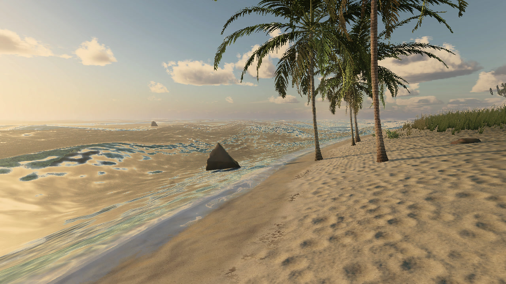

# Windward

A tropical island you can walk, swim, and fly — drawn in the browser with WebGPU as a single HTML file. Coast, ocean, reef, plants, weather, wildlife, and sound are generated when the page opens. No image, model, or audio assets.

In the same spirit as [Abyssal Garden](https://github.com/Noniv/abyssal-garden): one self-contained page, no engine, everything procedural. Shared techniques — water fog, caustics, plant sway, surface refraction, procedural ambience — are adapted here for a tropical island above and below the waterline.

**[Try it in your browser](https://jordanz00.github.io/Windward/)** · Best in Chrome. Also runs in Edge, and on a phone at Low detail. Free, MIT license.


## Try it

Open the [live page](https://jordanz00.github.io/Windward/), or clone the repo and open `index.html` in Chrome. WebGPU needs a normal browser context; if a local file open fails, serve the folder:

```bash
python3 -m http.server 4177
```

Wait for the coast to finish generating, then press **Enter**. First person on the beach: mouse looks, `W` `A` `S` `D` or arrows move. Click the view if look is not locked. **Places** flies to one of six spots. **Fly** (`F`) leaves the ground. **Watch** (`C`) hides the UI.

| | |
|---|---|
| Look | Mouse (click the view if needed). Esc releases |
| Move | `W` `A` `S` `D` or arrows · Shift run / boost |
| Jump | Space (on dry ground) |
| Ripple | Click the water (or tap on a phone) |
| Travel | Places · `1`–`6` |
| Fly | `F` · `W` follows look · Space up · `Q` down |
| Dive / rise | `Q` dive · Space rise while swimming |
| Watch | `C` · Esc restores controls |
| Time of day | Hour, or `T` (Shift reverses) |
| Weather | Weather, or `R` (Shift reverses) |
| Mute / audio | `M` mute · `N` music · `X` effects · `[` `]` music level |
| Frame time | `H` — FPS, CPU/GPU ms when available |
| Benchmark | `B` timed fly-through · `G` same path · `?bench=1` after Enter |
| Menu | `Esc` |

On a phone, drag to look; tap water to ripple. **Walk** puts you on foot; **Menu** brings the card back.

Low, Medium, and High are the same island with less or more detail. The choice is remembered; a failed load steps down one level.

Step into the water to swim; hold `Q` to dive. `6` puts you beside a coral head. `F` frees the camera from the ground.

| | |
|---|---|
|  |  |

## What is in the page

- **Island.** Fixed-seed coast with beach, cliffs, bay, and reef. Instanced palms, forest trees, grass, shrubs, and rocks; wind moves foliage.
- **Ocean.** Spectral swell and chop, nearshore run-up and foam, depth-based colour, reflections, and clickable ripples. Underwater: reef, seagrass, schools of fish, caustics, and Beer's-law fog.
- **Sky and weather.** Day cycle from dawn through night; weather states from clear to thunderstorm. Clouds cast shadows and shafts; rain, mist, and wind drive plants, sea, and sound.
- **Life and sound.** Insects near flowers and canopy; birds, surf, wind, and weather ambience. An original score (*Beneath the Blue*) can be toggled with `N`. Everything is synthesised in the Web Audio API — no recordings.

Capture helpers (`?tod=`, `?wx=`, `?shot=`, and related flags) are documented in [WINDWARD_NOTES.md](WINDWARD_NOTES.md).

## How it is built

`source/` is the readable copy. `node source/build.mjs` writes `index.html` and reports sizes. The shipped page strips comments and spare whitespace but keeps names so runtime errors still map to source. `node source/build.mjs --dev` packs the page without that strip.

| File | Role |
|---|---|
| `source/gpu.js` | Bind-group, layout, and pass helpers |
| `source/island.js` | Fixed-seed coast and bathymetry |
| `source/sky.js` | Atmosphere, weather map, clouds, panorama bake |
| `source/shaders.js` | Terrain, plants, air, and water WGSL |
| `source/ocean.js` | Spectral sea (FFT tiles) and shared wave lookup |
| `source/shore.js` | Nearshore run-up, foam, wet sand |
| `source/fish.js` | Reef, coral, seagrass, fish |
| `source/env.js` | Shared hour, sun/moon, weather, wind |
| `source/insects.js` | Insects and flowering shrubs |
| `source/app.js` | WebGPU app, camera, vegetation, audio |
| `source/bench.js` | Repeatable fly-through benchmark |
| `source/ui.css` | Overlay UI |
| `source/build.mjs` | Packs the files above into `index.html` |

Nothing is allocated per frame on purpose: uniforms, instance lists, and scratch matrices are reused. Plants and rocks are prototype meshes drawn as instances. Sunlight uses depth maps so trunks shade sand and water.

## Size

Kilobytes are 1024 bytes. `node source/build.mjs` prints current figures; roughly:

| | |
|---|---|
| Source (with comments) | ~595 KB |
| of which shaders (WGSL) | ~198 KB |
| `index.html` | ~375 KB |
| gzipped | ~130 KB |
| brotli | ~110 KB |

The page fetches nothing after load: no images, models, audio, fonts, or external scripts.

## Performance

Resolution follows frame rate: under ~40 fps the page draws fewer pixels (down to half the preset), and restores them when there is headroom. If the menu stays under ~22 fps on an auto-chosen preset, it reloads one level down. `?dyn=0` disables this; captures and the `B` benchmark never use it.

Plant density, cloud quality, shadows, reflections, and water detail stay at the chosen preset. Use `H` and `B` to compare builds by GPU milliseconds, not FPS alone.

## Known limits

- Requires WebGPU. Without it, the page shows a message instead of the island.
- High detail is aimed at a desktop GPU; use Medium or Low if the frame rate is poor.
- Thin palm leaflets can shimmer; optional `?msaa=4` helps where it works, but is known to break on at least one Mac.
- Phones run at Low detail; expect a modest frame rate on weaker devices.

## How it was made

A free-time open-source experiment. The founder works in multimedia, video, and animation — not as an experienced software engineer — and directed the build in [Cursor](https://cursor.com), primarily with Fable 5.2 and other models (Grok and Auto used sparingly). About a week of that work was enough to put something on GitHub. [WINDWARD_NOTES.md](WINDWARD_NOTES.md) holds compact notes on layout, systems, and trade-offs.

Main inspiration: [Abyssal Garden](https://github.com/Noniv/abyssal-garden) by Maksymilian Dendura.

## License

[MIT](LICENSE). The idea of a single-file procedural WebGPU world, and the shape of the controls, comes from Abyssal Garden (also MIT). The coast, shaders, and page are written for this project.
